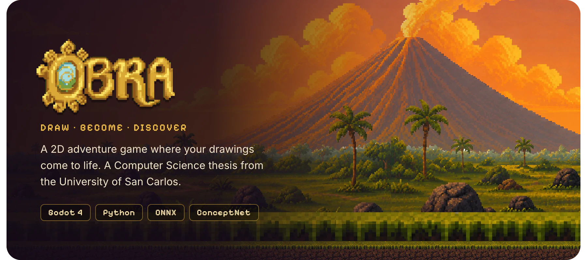
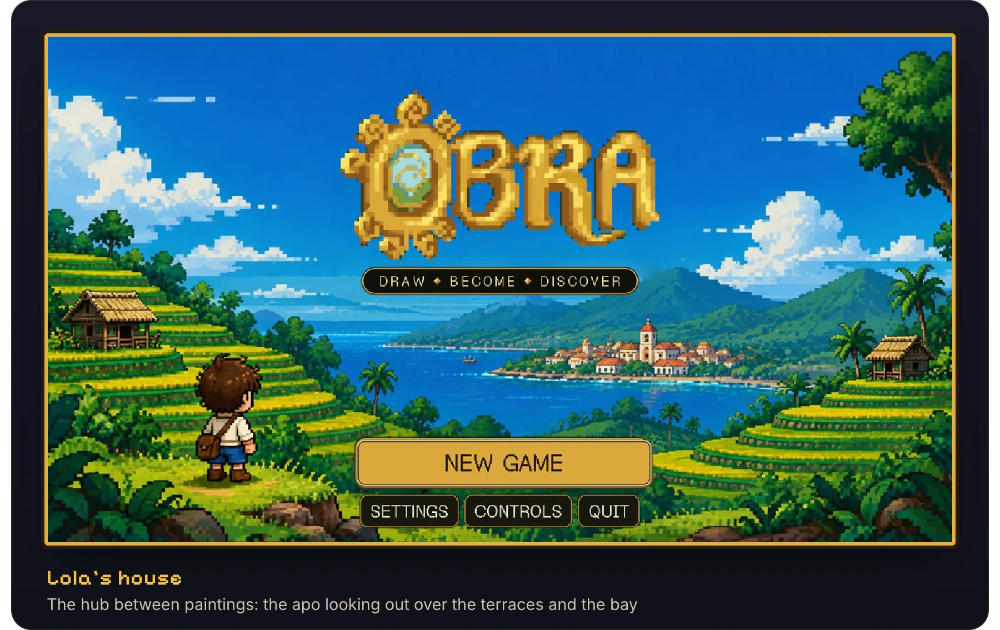
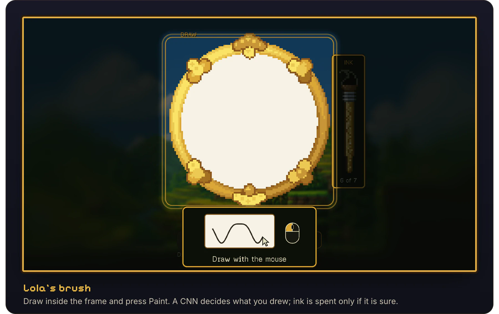
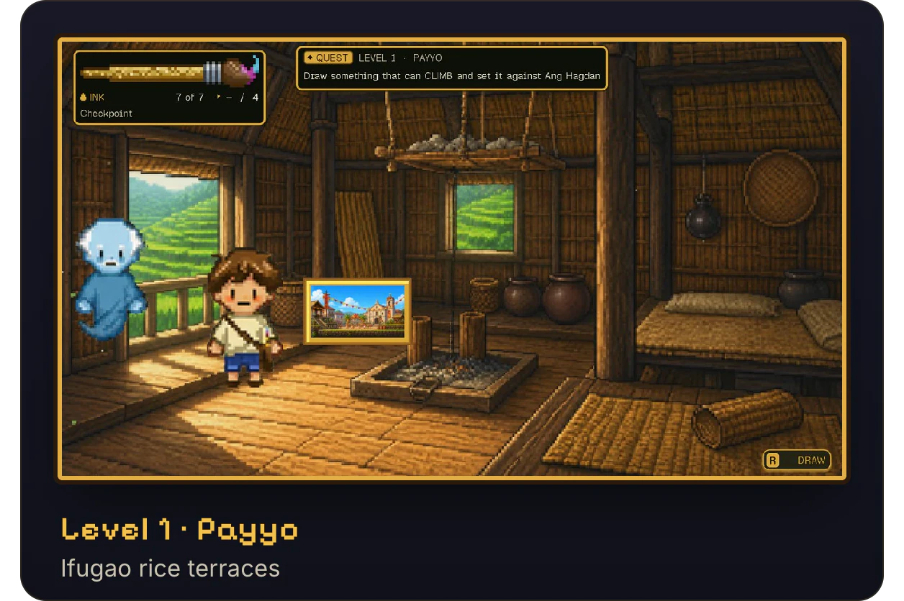
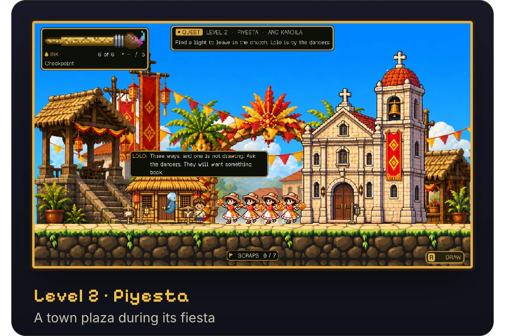
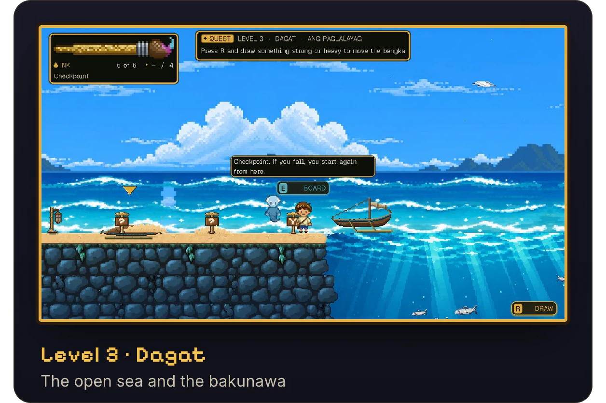
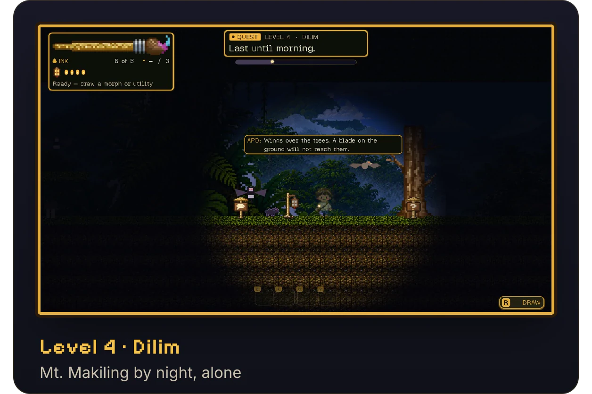
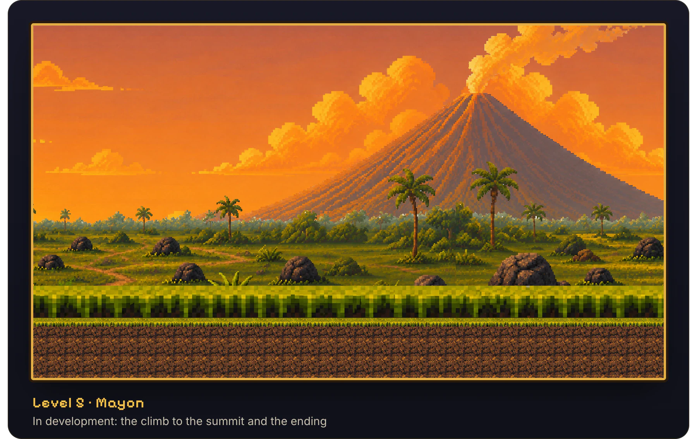

<div align="center">



<br />


</div>

<br />

You are the apo, a young girl pulled into Lola's paintings. Lolo, painted there long ago and not
quite a ghost, walks with you. In each world, Lola's brush lets you draw solutions into existence:

- **Draw a creature and become it**, with a physics body built from your own strokes.
- **Draw an object** and place it, carry it, or use it as a tool.
- **Solve obstacles more than one way** instead of following a single prescribed answer.
- **Explore Filipino settings**: the Ifugao rice terraces, a town fiesta, the sea of the
  bakunawa, Mt. Makiling at night, and the slopes of Mayon.

A Computer Science thesis project from the University of San Carlos, Cebu.

## Screenshots





<p align="center">
  <!--
  -->
</p>
<p align="center">
  <!--
  -->
</p>



## How it works

1. **Draw** - The Godot canvas keeps the raster image for recognition and the
   original stroke vectors for gameplay.
2. **Recognise** - A small CNN trained on Google's Quick, Draw! dataset
   classifies the sketch into a 50-class roster: 20 creatures, 3 physics shapes,
   and 27 objects.
3. **Validate** - The FastAPI backend runs ONNX Runtime locally. A result is
   accepted only when it clears the confidence and runner-up margin thresholds;
   declined drawings do not spend ink.
4. **Resolve** - ConceptNet-derived abilities are compiled into
   `game/config/abilities.json`, so gameplay does not query an external service.
5. **Play** - Creatures become active ragdolls driven by the player's stroke
   geometry. Objects become placeable utilities or tools, depending on the
   manifest's `ink_role`.

The backend classifies; Godot owns runtime animation, physics, placement, and
the meaning of each ability.

## Levels

| Level | Setting | Status |
|---|---|---|
| Lola's house | The hub between paintings | Playable |
| 1 · Payyo | Ifugao rice terraces of the Cordillera Central | Playable |
| 2 · Piyesta | A town plaza during its fiesta | Playable |
| 3 · Dagat | The open sea and the bakunawa | Playable |
| 4 · Dilim | Mt. Makiling by night, alone | Playable |
| 5 · Mayon | The last painting, coming apart on the volcano | Playable; the ending |

## Quick start

### Requirements

- [Godot 4.7](https://godotengine.org/download/archive/4.7-stable/) standard
  build (not .NET)
- Python 3.10 or newer
- Internet access on the first launch, to install the recogniser dependencies

The launchers create or update `.venv`, install
[`backend/requirements.txt`](backend/requirements.txt), verify the recogniser,
refresh Godot's import cache, and start the game. Run a launcher after cloning
and after pulling changes:

| Platform | Command |
|---|---|
| macOS / Linux | `./play.sh` |
| macOS | Double-click [`play_mac.command`](play_mac.command) |
| Windows | Double-click [`play_windows.bat`](play_windows.bat) |

**Development mode is on by default for everyone running from this repository.**
The shared flag is `debug/dev_mode/enabled=true` in [`game/project.godot`](game/project.godot).
All five paintings are unlocked through the normal house; collect the brush and play as usual.
**DEV MODE** stays visible on screen and appears in the window title. Set the flag to `false`
to restore progression locks. Release exports keep normal progression.

You can provide a Godot executable when it is not on `PATH`:

```bash
./play.sh /full/path/to/Godot
```

Or open `game/` in Godot and run the project directly after preparing the
backend environment:

```bash
python3 -m venv .venv
.venv/bin/python -m pip install -r backend/requirements.txt
godot --headless --path game --import
godot --path game
```

On Windows, use `.venv\Scripts\python.exe` instead of `.venv/bin/python`.

### If the game does not start

Check the recogniser independently:

```bash
.venv/bin/python backend/serve.py --check
```

It should print `OBRA_BACKEND_READY`. Godot and backend logs are stored in the
game's user-data folder:

- macOS: `~/Library/Application Support/Godot/app_userdata/O.B.R.A/`
- Windows: `%APPDATA%\Godot\app_userdata\O.B.R.A\`

The recogniser normally uses port 8000 and falls back to ports 8765-8774 when
that port is unavailable. It is owned by the game and exits with it.

## Development

### Project layout

| Path | Purpose |
|---|---|
| [`game/`](game/) | Godot client, scenes, gameplay scripts, art, UI, and Godot tests |
| [`backend/`](backend/) | FastAPI inference server and local lifecycle/telemetry support |
| [`model/`](model/) | Quick, Draw! download, training, ONNX export, and evaluation |
| [`shared/`](shared/) | Manifest and model-label validation shared by Python tools |
| [`tools/`](tools/) | Offline art builders, ability audits, suite runners, and telemetry reports |
| [`tests/`](tests/) | Python contract and backend tests |

The enabled entity roster is defined by
[`game/config/entities.json`](game/config/entities.json). If the roster or a
Quick, Draw! label changes, retrain/export the model so
[`model/labels.json`](model/labels.json) remains in the same order.

### Training and evaluation

Training requires the model dependencies:

```bash
python3 -m pip install -r model/requirements.txt
python3 model/download_data.py
python3 model/train_quickdraw.py
```

The training command produces the ONNX model, labels, metrics, and confusion
matrix. To evaluate against an external folder dataset:

```bash
python3 model/evaluate_folder.py --dir /path/to/dataset
```

### Tests

Run the complete project suite:

```bash
tools/run_suites.sh
```

Run only the suites relevant to a change:

```bash
tools/run_suites.sh only run_tests python
```

Useful focused checks include:

```bash
python3 -m unittest -v tests.test_manifest_contract
python3 -m unittest -v tests.test_backend_lifecycle
godot --headless --path game --script res://tests/run_tests.gd
godot --headless --path game --script res://tests/run_level1_audit.gd
godot --headless --path game --script res://tests/run_level2_audit.gd
```

Some visual and input suites require a real window. Headless suites use an
isolated test profile and telemetry directory; they do not modify a player's
save data.

### Design and level notes

- [`LEVEL_TEMPLATE.md`](LEVEL_TEMPLATE.md) describes the structure and
  contracts for new levels.
- [`LEVEL_1.md`](LEVEL_1.md) through [`LEVEL_4.md`](LEVEL_4.md) document each
  level's design decisions and build record.
- [`GATES.md`](GATES.md) describes the gameplay rules and acceptance checks.
- [`game/README.md`](game/README.md) contains Godot-client-specific notes.

## Persistence and telemetry

Progress is stored locally in a schema-versioned JSON profile at
`user://profile.json`. Recognition and gameplay telemetry are anonymous and
remain on the player's computer in `user://telemetry/`. Use
`tools/aggregate_telemetry.py` to summarise local telemetry.

Test runs use `user://test_runs/` instead of the real profile and telemetry
locations.

## Built with

| Layer | Tools |
| --- | --- |
| Game | Godot 4.7, GDScript |
| Recogniser | PyTorch for training, ONNX Runtime for inference, NumPy, Pillow |
| Server | FastAPI, run locally and owned by the game process |
| Knowledge | ConceptNet, compiled offline into `game/config/abilities.json` |

## Team

A thesis project of the Department of Computer, Information Sciences and
Mathematics, University of San Carlos, Cebu, Philippines.

<table>
  <tr>
    <td align="center"><a href="https://github.com/kntucky-y"><br /><sub><b>kntucky-y</b></sub></a></td>
    <td align="center"><a href="https://github.com/2232-Api"><br /><sub><b>2232-Api</b></sub></a></td>
    <td align="center"><a href="https://github.com/k-ains"><br /><sub><b>k-ains</b></sub></a></td>
    <td align="center"><a href="https://github.com/hyuuuan"><br /><sub><b>hyuuuan</b></sub></a></td>
  </tr>
</table>

## Credits

- Sketches: Google's [Quick, Draw!](https://github.com/googlecreativelab/quickdraw-dataset), CC BY 4.0.
- Commonsense knowledge: [ConceptNet](https://conceptnet.io), CC BY-SA 4.0.
- Outside evaluation: the TU-Berlin sketch dataset (Eitz, Hays, and Alexa, 2012).
