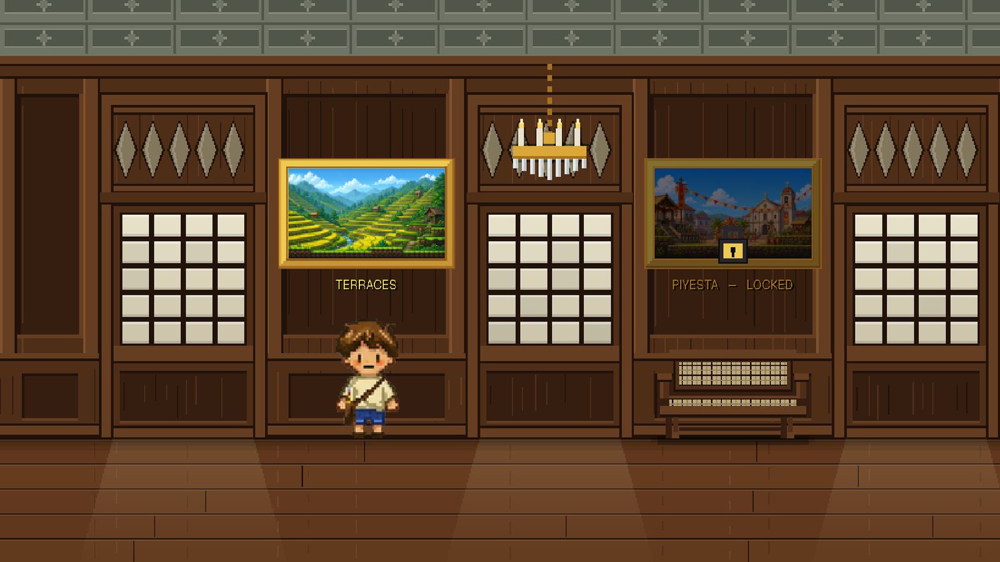
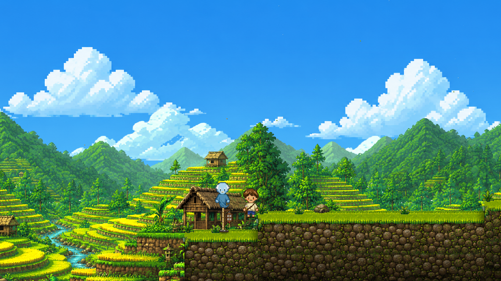
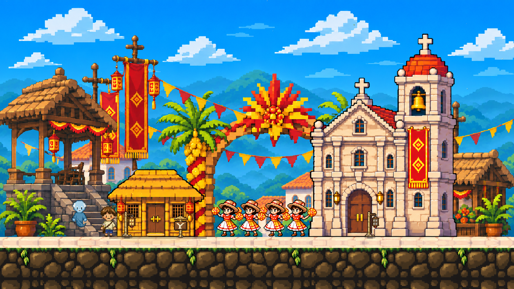
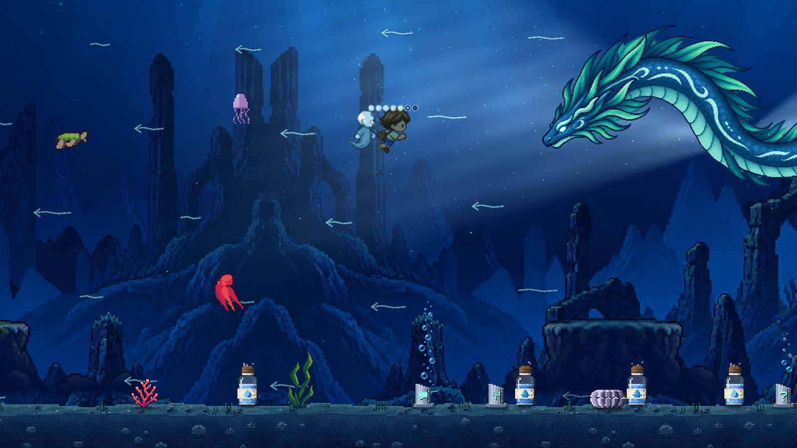
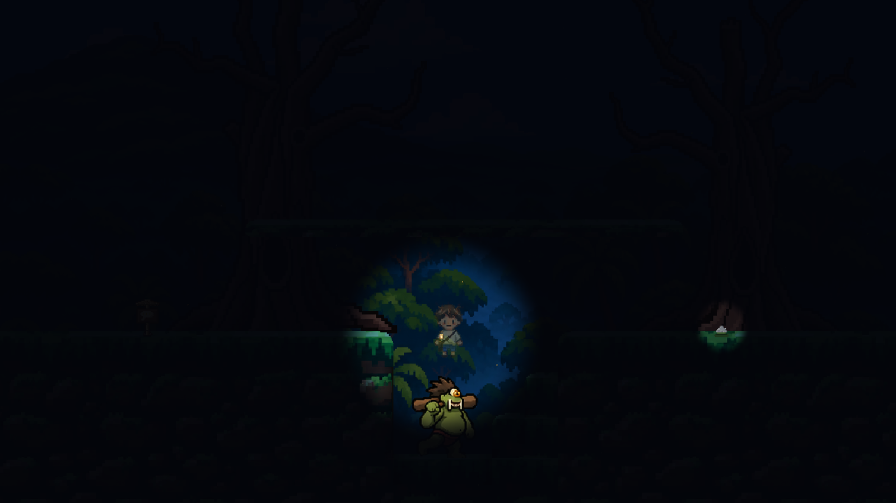
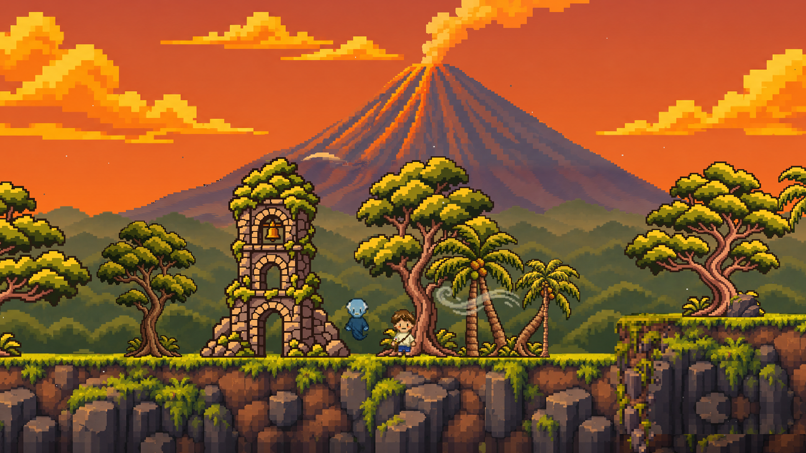

# OBRA: A Review Brief for Teachers

**What we are asking you to check:** whether a game set in the Philippines shows its places,
people, beliefs and celebrations accurately and respectfully.

**Research team:** Rusk Rye Ioan C. Alarde, Erika Bianca E. Api, Kent Jester P. Gatchalian and
Lady Kaina V. Gutierrez, BS Computer Science, University of San Carlos, Cebu City
**Adviser:** Christine F. Peña, MMath
**Time needed:** about an hour in all: 15 minutes for this brief, about 30 to play the game (or
10 for the demonstration video, if you prefer not to play), and 20 for the questionnaire.

---

## Before you begin

Thank you for agreeing to help.

We are Computer Science students, not teachers of culture or history. We made this game, and
the Filipino content in it is our own work. You teach these places and traditions to children
every year, so you are well placed to tell us where we got something wrong.

Please keep three things in mind:

- **We are not asking you to use this game with your pupils.** It was not made for children and
  has not been tested with anyone under eighteen. We are asking only for your judgement of its
  content.
- **Criticism is the most useful thing you can give us.** There are no right answers. If
  something is inaccurate, stereotyped or disrespectful, please say so plainly.
- **You choose whether you are named.** You are one of six to eight teachers on a review panel.
  If you agree, we thank you by name in the thesis; if not, we describe you only by the subject
  and grade you teach and your years of teaching. Either way, no one outside the research team
  sees your individual answers, and nothing is reported to your school.

This brief tells you what the game shows, which parts are real, which parts we changed, and
which parts we made up. The questionnaire then asks what you think.

---

## 1. What OBRA is

OBRA is a single-player computer game. The player moves a character through painted worlds and
gets past obstacles **by drawing**. If the player draws something with the mouse, the computer
recognises what it is and the drawing comes to life in the game. A drawing of a boat floats; a
drawing of a bird flies.

The word *obra* means a work of art, a masterpiece.

**The story.** *The player is the apo, the grandchild of Lola, a painter who is losing her
memory. In Lola's house, the apo picks up her brush and is pulled into one of her paintings.
There she meets Lolo, Lola's husband, who died years ago; in the paintings he is a gentle
spirit, made, he says, of "paint and memory", and he becomes her guide. Each of the five
levels is one of Lola's paintings of a place she loved, and in each the apo finds pages of
Lola's diary that show her forgetting. In the last painting, Mayon, the world itself is going
white as Lola forgets: Lolo fades away, and at the summit the apo finds Lola painting and helps
her see the places she loved again. The game ends back in Lola's house, where Lolo is painted
into every picture and Lola, who no longer knows the apo, asks her to stay and watch her
paint.*

**The characters.**

| Character | Who they are in the story | Shown as |
|---|---|---|
| The apo | The player's character: Lola's grandchild, a girl who visits her on Sundays. Her age is never stated. Nobody uses her name; everyone calls her "apo". | A small pixel-art child in a cream shirt, blue shorts and a shoulder bag, drawn by our artist. A few poses in the last level are temporary stand-ins. |
| Lola | The apo's grandmother, a painter. Her memory is failing, though the game never names an illness. She does not appear in Levels 1–4 except through her paintings, her diary and what others say of her. The apo meets her at the summit of Mayon and again in her house. | A pixel-art grandmother drawn by our artist. Two poses, holding flowers, are temporary computer-made stand-ins. |
| Lolo | Lola's husband, who drowned at sea years before the story. Inside the paintings he is a spirit who guides the apo through Levels 1 to 3. He stops at the end of Level 3, because he does not remember the places beyond it. In Mayon he returns, losing his words as Lola forgets him, and vanishes in the middle of a sentence. | A pale blue, see-through spirit. In the house at the end, a small figure painted into each of Lola's pictures: young in the first, old in the last. |
| The priest ("Padre") | The parish priest in Level 2, who tells the apo where Lola went after she prayed. | An elderly priest in black, drawn by our artist. |
| The dancers | A troupe dancing in the plaza in Level 2. They are not named. | Pixel-art dancers in straw hats and red-and-white dresses. |
| The creatures of the forest | Eleven creatures from Philippine folklore in Level 4. See Level 4 below. | Pixel art: most by our artists; the santelmo and the tik-tik are still temporary stand-ins. |

**Screenshot:**

---

## 2. Why we are asking you

The places in the game are ones the elementary curriculum covers. We list them here so you can
see where we think the game meets your subject. **A link in this table means the topic appears
in the MATATAG curriculum guide. It does not mean the game teaches it, or teaches it well.**
That is for you to judge.

| Level | Setting | Where the topic appears in the MATATAG curriculum |
|---|---|---|
| 1. Payyo | Rice terraces of the Cordillera | Araling Panlipunan 4, Q1: landforms; indigenous peoples and ethnolinguistic groups |
| 2. Piyesta | A Visayan street festival | Music and Arts 4, Q4: celebrations in the province and region · Makabansa 3, Q2: arts and culture of the wider community |
| 3. Dagat | The sea and a coastal fishing life | Araling Panlipunan 4, Q1: bodies of water; Q2: natural resources and livelihoods · Araling Panlipunan 5, Q2: traditions such as boat-building · Music and Arts 4, Q3: legends and folklore |
| 4. Dilim | A forest at night, with creatures from folklore | Music and Arts 4, Q2: faiths and beliefs; Q3: legends and folklore · Araling Panlipunan 5, Q2: beliefs of early communities |
| 5. Mayon | Mayon Volcano, in Bicol | Araling Panlipunan 4, Q1: landforms |

Your school may teach these in different terms under this year's three-term calendar. The
questionnaire asks which subjects you teach, so that we can read your answers in that light.

---

## 3. The five levels

Each level below gives the same five things: what the player sees and does; the facts we used;
what we changed or made up; the Filipino words that appear; and the questions we most want you
to look at.

### Level 1: Payyo

**Screenshot:**

**What the player sees and does.** The apo wakes on rice terraces in the Cordillera mountains,
in the morning, with Lolo beside her. It is quiet: there are no other people. The painting has
worn through in places. An old stone stair has fallen, the hanging bridge over a gorge has
rotted away, and Lola's house stands on its posts with no way up. At each obstacle Lolo gives
three ways past (mend it, go around it, or cut through it), and the player draws something to
do it. Inside the house the apo finds a photograph of Lola as a young woman, and the next
painting, of a fiesta.

**The facts we used.** All of these are said by Lolo unless marked.

| What the game shows or says | Label | Our source |
|---|---|---|
| "The Ifugao carved every one of these terraces into the mountain by hand." | REAL | [[SOURCE NEEDED]] |
| "If you laid the walls end to end, they would stretch halfway around the world." | REAL (a common saying, not a measurement) | [[SOURCE NEEDED]] |
| "These are the Rice Terraces of the Philippine Cordilleras … a UNESCO World Heritage Site." | REAL | [[SOURCE NEEDED]] |
| Ifugao families keep their own woodlots, the *muyong*, so the water keeps running down to the terraces. | REAL | [[SOURCE NEEDED]] |
| The *hudhud* is chanted at harvest; some take days to sing; UNESCO counts them among the world's treasures. | REAL | [[SOURCE NEEDED]] |
| The *bulul* by the granaries are "guardians of the rice". Two sit near Lola's house. They cannot be touched or used, and Lolo warns: "Those are not decoration, and they are not yours." | REAL | [[SOURCE NEEDED]] |
| *Tinawon*, an heirloom rice planted only once a year. | REAL | [[SOURCE NEEDED]] |
| The carabao works the paddies all over the Philippines. | REAL | [[SOURCE NEEDED]] |
| The apo: "Two thousand years, the books say." Lolo: "Four hundred years, apo. This was not left behind. It is an answer." | REAL (one scholarly view; the age of the terraces is still debated) | [[SOURCE NEEDED]] (our design notes credit this dating to the Ifugao Archaeological Project, but no publication is recorded) |
| Lola's house is drawn as an Ifugao *bale*: on four posts, with no windows and a steep thatched roof. Lolo says: "You take the way up inside at night", and the posts "carry rat guards". | REAL | [[SOURCE NEEDED]] |

**What we changed or made up.**
- **The name.** On screen this level is called **"Terraces"**. "Payyo" (which our design
  notes give as the Ifugao word for the pond field) is only our working name; it never
  appears in the game.
- **Tagalog labels in an Ifugao place.** The heading that names each obstacle uses Tagalog:
  *Ang Hagdan* (the stair), *Ang Tulay* (the bridge), *Ang Dayami* (the straw), *Ang Bale*
  (the house).
- **No bahay kubo.** An early plan named this level "Bahay Kubo". We dropped it, because the
  bahay kubo is a lowland house and Lola's house here is a *bale*. However, the small houses in
  the painted background, and a wooden hut near the start, are general thatched huts that we
  have not checked against Ifugao building.
- **Lola's chest is locked with a padlock.** Ifugao houses had no locks, so Lolo explains that
  she carried the chest up from the lowlands. (INVENTED)
- **Invented details:** the bridge "my grandfather's grandfather made", the fallen stair, a key
  hidden in a haystack, and Lola's painting things in the valley. (INVENTED)
- **A family's forest can be cut.** One way past the gorge is to cut a tree at the edge of a
  *muyong*. Lolo says what it costs ("That is the water for every terrace below"), and the
  terrace below stays dry afterwards. (ADAPTED)
- **On purpose:** no village or clan is named. The only person met is Lolo, and the cave holds
  one of Lola's pressed flowers, never burials. The landscape is squeezed: everything is closer
  together than in a real valley.

**Filipino words in this level.**
- *apo* (grandchild): what Lolo calls the player.
- *Lola*, *Lolo* (grandmother, grandfather): used as names.
- *Ang Hagdan*, *Ang Tulay*, *Ang Dayami*, *Ang Bale* (the stair, the bridge, the straw, the
  house): in the heading at each obstacle.
- *Ay*: Lolo's exclamation.
- *muyong*, *hudhud*, *bulul*, *tinawon*: in Lolo's lines about the terraces.
- *Pista*: the name of the painting the apo finds, which opens Level 2.

**Please look closely at:**
1. Is it right to title the level "Terraces", or to call the place *Payyo*, and to label an
   Ifugao place with Tagalog words (*Ang Hagdan*, *Ang Bale*)?
2. Are the *bulul*, the *muyong* and the *bale* shown respectfully? Is Lolo's correction of
   "two thousand years" fair to present to a player?

### Level 2: Piyesta

**Screenshot:**

**What the player sees and does.** The second painting is a town plaza on its fiesta day. It
has a stone church with a bell tower, a raised wooden pavilion, bunting across the street, and
dancers in the square. Lola was here that morning. First the apo must find a candle to light
for her in the church. She can dance with the dancers, who give her one; let herself into a
house; or scare the crowd away, after which the dancers never come back. The priest then tells
her that Lola left by the back, into the alleys behind the plaza. In the two alleys, birds have
carried off the **seven scraps** of Lola's next painting (of the sea) to their nests in the
bunting. The apo gets them back by feeding the birds, by climbing up and cutting the strings,
or by throwing stones. The level's title on screen is **"Piyesta"**. No town or saint is
named for this plaza. Only one of Lolo's lines links it to a real festival: "She painted this
fiesta like the Sinulog of Cebu."

**The facts we used.** All said by Lolo.

| What the game shows or says | Label | Our source |
|---|---|---|
| The Sinulog of Cebu falls on the third Sunday of January, and "the whole city dances for the Santo Niño". | REAL | [[SOURCE NEEDED]] |
| "Sinulog comes from 'sulog' — the current of the water. Two steps forward, one step back, so the dance moves like a river." | REAL | [[SOURCE NEEDED]] |
| "Everyone shouts 'Pit Señor!' It means calling out to the Lord, asking Him to hear you." | REAL | [[SOURCE NEEDED]] |
| "The Santo Niño of Cebu was a gift to Queen Juana in 1521. It is the oldest Christian image in the Philippines." | REAL | [[SOURCE NEEDED]] |
| "They built the Basilica around it." | ADAPTED (simplified) | [[SOURCE NEEDED]] |
| Four churches, in Manila, Paoay, Santa Maria and Miagao, are UNESCO World Heritage Sites: the Baroque Churches of the Philippines. | REAL | [[SOURCE NEEDED]] |
| "Earthquake Baroque": thick walls and great buttresses so earthquakes cannot knock them over. | REAL | [[SOURCE NEEDED]] |
| San Agustin in Manila is the oldest stone church in the country, standing since 1607. | REAL | [[SOURCE NEEDED]] |
| Every town keeps a fiesta for its patron saint; houses open their tables, and "nobody walks home hungry". | REAL (a general description) | [[SOURCE NEEDED]] |
| Lighting a candle at the church's candle rack for someone. | REAL | [[SOURCE NEEDED]] |

**What we changed or made up.**
- **The fiesta is not a real one.** Lolo compares it to Sinulog, but the plaza is not drawn as
  Cebu. The church is a general Spanish-era church, not the Basilica. The dance the player does
  is a timing game, not the Sinulog dance.
- **Two festivals are mixed.** The plaza painting was first drawn after the Pahiyas of Lucban,
  Quezon. Its tall arch with a coloured crown still looks like Pahiyas decoration, although
  the words now point to Sinulog. (ADAPTED)
- **Religious content.** The cross, the altar and any sacred image in the church are part of
  the painted background: nothing sacred can be touched, cut, climbed on or used. The only act
  in the church is setting a lit candle on the rack. No Mass, procession or prayer is shown or
  played.
- **Invented:** the birds that steal the scraps and nest in the bunting; the dancers giving a
  flower for a dance; the crowd that never returns once scared away.
- **Lola's diary pages** found here are ours (INVENTED). In them she forgets a prayer she has
  said for sixty years, and gets lost among streets that all have bunting, until a boy from the
  sari-sari store walks her home.

**Filipino words in this level.**
- *Piyesta*, *pista* (fiesta): the level's title; Lolo also says "At a pista everyone brings
  what they can."
- *Naku*, *Hoy*: Lolo's exclamations.
- *Ang Kandila* (the candle), *Ang Unang Eskinita* (the first alley), *Ang Ikalawang Eskinita*
  (the second alley): in the heading.
- *Padre*: the priest's name on screen.
- *sari-sari* store: in Lola's diary.
- *Sinulog*, *sulog*, *Pit Señor*, *Santo Niño*: in Lolo's lines.

**Please look closely at:**
1. Is it acceptable to tie this plaza to Sinulog when its art came from Pahiyas, and to
   describe a sacred image and a religious feast in a game?
2. The alleys behind the plaza are narrow and dark, with a sari-sari store and a busy market
   street at sunset. Do they show an ordinary neighbourhood fairly, without making it look poor
   or dangerous? (questionnaire item 16)

### Level 3: Dagat

**Screenshot:**

**What the player sees and does.** On a beach, the apo finds a new brush. With it she can stay
in a drawn shape for as long as her ink lasts. To cross the sea she chooses between two ways.
She can dig out a beached **bangka** and row it, with Lolo aboard, or she can turn into a
sea creature and swim under the water, past coral, turtles, jellyfish and fish. A storm rises.
Both ways lead to the **bakunawa**, a huge blind sea serpent going back and forth "the way a
person does when they have lost something in the house". It ends one of three ways: she shows
it the way home with a light (it gives her something in thanks), slips past it in the dark, or
fights it with drawn weapons until it gives up and dives away. It is never killed. On the
island beyond, Lolo tells her how he died ("I went over and I did not come up") and says
goodbye, because he does not remember the places past here.

**The facts we used.** All said by Lolo.

| What the game shows or says | Label | Our source |
|---|---|---|
| "More than seven thousand islands. Seven thousand six hundred and forty-one, at the last count." | REAL | [[SOURCE NEEDED]] |
| More kinds of reef life live in Philippine waters than almost anywhere else. | REAL | [[SOURCE NEEDED]] |
| The bangka's bamboo outriggers keep it from tipping over in rough water. | REAL | [[SOURCE NEEDED]] |
| The *balangay*; one dug up in Butuan is more than a thousand years old. | REAL | [[SOURCE NEEDED]] |
| "The old Visayans told of the bakunawa — a great sea serpent that rose from the deep to swallow the moon." People banged pots and pans until it spat the moon out, and that is how they explained an eclipse. There were once seven moons, and it swallowed six. | REAL (Visayan folk belief) | [[SOURCE NEEDED]] |
| Tubbataha Reef in the Sulu Sea may be visited only a few months of the year. | REAL | [[SOURCE NEEDED]] |
| The butanding feeds at Donsol; "the fishers there used to hunt it. Now they guide people to swim beside it." | REAL | [[SOURCE NEEDED]] |
| *Bangus*: "the whole country chose that one as its own"; raised in Pangasinan and Bulacan; cooks in Dagupan take out the bones with tweezers. | REAL | [[SOURCE NEEDED]] |
| *Pawikan*: five of the world's seven kinds swim in Philippine seas, they return to the beach they hatched on, and they are protected by law. | REAL | [[SOURCE NEEDED]] |
| *Pugita*: three hearts, blue blood, quick colour change; hung to dry on bamboo racks in the Visayas. | REAL | [[SOURCE NEEDED]] |
| *Dikya* sting, and "some dikya in our waters glow in the dark; the old fishermen used to steer home by them at night." | ADAPTED (the glow is real; we have no source for the steering) | [[SOURCE NEEDED]] |

**What we changed or made up.**
- **Our bakunawa is not the moon-eater of the story.** It never goes near the moon. It is
  blind, frightened and searching for something it lost. We built it to mirror Lola, who is
  also losing things. At the end the apo says to her: "The deep, and the one that searched
  it. It was looking for you." It is drawn as a long sea dragon with fins and a mane (see the
  screenshot). (ADAPTED)
- **The first fighting in the game** is the fight with the bakunawa, and it is only one of
  three choices. While in a creature's shape, the player can also attack the sea animals. Lolo
  objects every time ("The sea is not ours to empty"), and the stinging creatures turn on her.
- **The place is not named.** The coast and the island are painted, not a real location.
- **Invented:** Lolo's death at sea, the new brush, the jars of ink on the seabed, the storm,
  and the old hook Lola's father fished with.
- **Lola's illness is never named.** Lolo says only, "She does not always know me now." In a
  diary page, a doctor writes a word down, and Lola says, "I will not write its name in here."

**Filipino words in this level.**
- *Dagat* (sea): the level's title.
- *bangka*: Lolo's wooden boat.
- *Ang Paglalayag* (the voyage), *Ang Bakunawa*: in the heading.
- *bakunawa*: the sea serpent.
- *pawikan* (sea turtle), *dikya* (jellyfish), *pugita* (octopus), *bangus* (milkfish),
  *butanding* (whale shark): in Lolo's lines.
- *balangay*: the ancient boat.

**Please look closely at:**
1. Is it acceptable to change the bakunawa from the moon-swallowing serpent into a lost, blind
   creature that stands for a grandmother's forgetting?
2. Is the way Lolo tells of his drowning, and the fishing life around it, fitting and
   respectful?

### Level 4: Dilim

**Screenshot:**

**What the player sees and does.** The fourth painting is a forest on **Mount Makiling**, at
night. Lolo cannot come ("Lolo stopped at the water"), so the apo goes alone with a lantern,
and she sees only what its light reaches. Lola left her a bestiary: diary pages describing
each creature, written "so you know them, if you ever meet one". The bestiary opens at a
creature's page the first time the apo meets it. Each creature can be passed without fighting,
by light, by a respectful word, by a trick, or by going around, but the apo can also fight
with drawn weapons. **The lantern is her health.** It has four stages: full, dim, low and
guttering. Each hit dims it one stage, and a hit while it is guttering sends her back to the
last rest clearing. In the final clearing the aswang come in waves, and she has only to last
until morning. Along the way the apo also says a few true things about the mountain: Los Baños
is named for its hot springs; people say the mountain has a keeper, Maria Makiling, and that
whoever takes from her forest without asking will not find the way down; seen from the lake,
the mountain looks like a woman lying on her back; and its forest is now kept for study. (All
REAL; [[SOURCE NEEDED]].)

**The creatures.** These come from Philippine folklore. We want to know whether we have shown
them in a way their sources would recognise. The middle columns quote Lola's bestiary, which
is how the game tells the player about each one.

| Creature | What it is in folklore, as we understood it | What it does in the game | What answers it in the game | Our source |
|---|---|---|---|---|
| Aswang | A creature that hunts people at night. The game gives it no bestiary page; the apo says only "Salt burns them. Garlic keeps them off." | Comes in waves in the final clearing. Two looks: a pale woman with long black hair in a blood-stained white robe, gliding; and a pale crawling figure with red eyes and a long red tongue. Nothing in the game says the aswang stands for Lola's grief. | Thrown salt, crushed garlic, drawn weapons, and lasting until dawn. Drawing a sun brings the morning nearer. | [[SOURCE NEEDED]] |
| Kapre | "Big as a house, up in the balete, smoking. It keeps to itself, but its smoke turns you round." | Sits smoking in a balete tree; its smoke turns the apo back to where she came in. | Something that brings wind to clear the smoke; felling its tree, so it goes to find another; or knocking the cigar from its hand. | [[SOURCE NEEDED]] |
| Tikbalang | "Tall, all legs, its face long … It walks you in circles until you give up." | Brings her back to the same rock again and again. | Drawing a horse ("It lets its own kind through"); becoming any animal ("It does not chase what it does not hunt"); or racing it to the far side ("it hates to lose a race … and it keeps its word"). | [[SOURCE NEEDED]] |
| Manananggal | "Only half of her flies. Find where she left the rest of herself, and salt it. Or keep her busy until morning. She cannot come back together in the light." | Her upper half flies; her lower half stands on the path. Returns in the final clearing. | A drawn sun; salt on the lower half; or driving the upper half off. | [[SOURCE NEEDED]] |
| Sigbin | "It walks backwards, its head low between its legs. It waits where it is darkest and comes at you from behind … It cannot bear to be seen." | Leaves tracks that go backwards, and attacks from behind. | A light; putting her back to a rock; or striking its shadow. | [[SOURCE NEEDED]] |
| Tiyanak | "If you hear a baby crying in the woods, do not go to it … It is not a baby. The light shows it for what it is." | Cries like a baby beside the path. | A light, or staying on the path. Fighting it is possible but earns nothing. | [[SOURCE NEEDED]] |
| Bungisngis | "One eye, and it laughs at everything. Laughing is the only thing stronger than it is." | A giant laughing on the far side of a gap. | Drawing something absurd (a sea creature or boat in a forest), so it laughs too hard to stand; crossing the gap; or fighting. | [[SOURCE NEEDED]] |
| Nuno sa punso | "He lives in the punso, the mound beside the path. Do not step on it. Say tabi-tabi po, excuse me, and he lets you by. Step on it and your foot swells." | A mound on the path with offerings around it. He comes out as she nears. | Stopping, saying "Tabi-tabi po", and going around, which earns a flower. He can never be attacked. Stepping on the mound slows her for a while. | [[SOURCE NEEDED]] |
| Santelmo | "A ball of fire drifting in the dark. It is only lost. Never run from one. It chases whatever runs." | A flame that follows her, faster if she runs. | Walking slowly. | [[SOURCE NEEDED]] |
| Wakwak | A flying night creature. It has no bestiary page. | Flies in during the final clearing, hangs high, then dives. | Stepping aside "at the glint"; weapons; lasting until dawn. | [[SOURCE NEEDED]] |
| Tik-tik | "Tik, tik. When it sounds far away, it is close. Ash shows it." | An unseen creature in the last wave. | Throwing ash to reveal it, then avoiding it until dawn. | [[SOURCE NEEDED]] |

**What we changed or made up.**
- **Many of the answers are ours.** These are INVENTED: racing the tikbalang, drawing a horse
  for it, clearing the kapre's smoke with wind, making the bungisngis laugh with something
  absurd, ash revealing the tik-tik, and a drawn sun for the manananggal. We believe these
  others come from folk tradition, but have no recorded source: salt and garlic against the
  aswang and manananggal, "tabi-tabi po" for the nuno, the tiyanak's baby cry, and the
  tikbalang leading people in circles.
- **Creatures from different parts of the country share one forest** on Mount Makiling.
  (ADAPTED)
- **One aswang is drawn as a "white lady"**, in a white robe shaped like a Japanese kimono.
  The white lady is a separate figure in Filipino ghost stories; we borrowed her look for the
  aswang.
- **Fighting is a game choice, not a folk practice.** The apo fights with drawn weapons (a
  sword, an axe and so on), and beaten creatures fade away. Every creature can also be passed
  without a fight.
- **The bestiary's voice is invented.** The pages are Lola's, and they show her forgetting: she
  writes the sigbin's name where the manananggal's should be, loses a word, and ends: "I think I
  have written one of these twice."

**Filipino words in this level.**
- *Dilim* (darkness): the level's title.
- The creatures' names, as in the table above.
- *punso* (mound), *balete* (the tree), *tabi-tabi po* ("excuse me", said to beings you cannot
  see).
- Lola's things the apo carries: *asin* (salt), *bawang* (garlic), *langis* (lamp oil), *abo*
  (ash), *kandila* (candle), *buntot pagi* (stingray tail, used as a whip).
- *Ang Punso*, *Ang Sigbin*, *Ang Tikbalang*, *Ang Kapre*, *Ang Tiyanak*, *Ang Bungisngis*,
  *Ang Manananggal*: in the heading.
- *Los Baños*, *Maria Makiling*: in the apo's lines about the mountain.

**Please look closely at:**
1. Is each creature recognisable to someone who grew up with these stories? Is it acceptable
   to give each one a "weakness" the player can use, especially the ones we invented?
2. Is it respectful to draw the aswang as a white lady in a kimono-like robe, and to put
   creatures from different regions in one forest?

### Level 5: Mayon

**Screenshot:**

**What the player sees and does.** The last painting is Mayon Volcano at sunset, smoking, with
a ruined stone bell tower among the trees at its foot. Lolo is there again, though he says, "I
was never in this one." Ash falls, and whatever it settles on goes white, then blank: "Not
burnt, not broken. Just -- not painted any more." The apo works out that this is Lola forgetting.
Her ink is limited to six drops, with no refills. Halfway up, twelve pieces of the earlier
paintings start to go white: the terraces, Lola's house, the church, the dancers, the fiesta
flags, the storm, the bangka, the reef, the bakunawa, the forest, the falls and a flower. She
has ink to save about four of them, by drawing something that belongs in each. Lolo loses his
words as they climb. Near the top she tries to draw him back, the brush refuses, and he
vanishes mid-sentence. At the summit Lola is painting with her back turned, and the brush will
not draw her either. So the apo draws the places instead, the pieces she saved bloom around
Lola, and Lola turns. The apo says, "Lolo. Let's go home." The game ends in Lola's house, not
on the mountain.

**The facts we used.**

| What the game shows or says | Label | Our source |
|---|---|---|
| Mayon's near-perfect cone, shown smoking, with glowing lava channels. | REAL (the shape); ADAPTED (it is shown erupting throughout) | [[SOURCE NEEDED]] |
| Falling ash. | REAL (ash falls from Mayon's eruptions); INVENTED (that it turns the world white, then blank) | [[SOURCE NEEDED]] |
| A ruined stone bell tower at the foot of the volcano, drawn after the Cagsawa belfry. The game never names it or says how it was ruined. | ADAPTED | [[SOURCE NEEDED]] |
| Lolo: "Your lola and I came up here once." | INVENTED | not applicable |

**What we changed or made up.**
- **The game says nothing about Bicol or Albay, the people who live near Mayon, or its real
  eruptions.** The volcano is a setting for the ending, and the ash stands for forgetting.
- **We did not use the legend of Daragang Magayon.** Nothing in the level refers to it.
- **The apo climbs to the summit** of an active, smoking volcano. The game does not mention the
  real limits on going near Mayon's crater.
- **Invented:** the pieces of the other paintings floating on the mountain, the limited ink,
  Lolo's vanishing, Lola painting at the summit, and the ending in her house.
- **Stand-in art.** Much of this level's art (the cliffs, trees, ruins, and some of Lola's and
  the apo's poses) is temporary computer-made art, still waiting for review by our artists. The
  level has no music or sound.

**Filipino words in this level.**
- *Mayon*: the level's title.
- *Mahal* (dear, love): what Lola calls Lolo, and what she calls the apo when she mistakes her
  for him: "Mahal! You look so young!"
- *Ang Bale*, *bangka*, *bakunawa*: the names of pieces of the earlier paintings.

**Please look closely at:**
1. Is a real volcano, which has forced families from their homes, a fitting place for a story's
   sad ending? And is it right to show the Cagsawa ruin without telling its story?
2. Is it respectful to show a grandmother's forgetting this way: Lolo vanishing, and Lola no
   longer knowing her grandchild at the end?

---

## 4. Words we use without translating

The game keeps some Filipino words in English text on purpose. Please tell us if any is used
wrongly, or if one would sound strange to a Filipino player.

| Word | Meaning as the game uses it | Where it appears |
|---|---|---|
| Lola | Grandmother. Used as her name: "Lola's house", "your lola". | Every level, and the house |
| Lolo | Grandfather. Used as his name, by the apo and by Lola. | Every level, and the house |
| apo | Grandchild. Used as the player's name: Lolo calls her "apo" in almost every line. | Every level |
| bahay kubo | **Not used.** An early plan named Level 1 "Bahay Kubo"; we dropped it because the house there is an Ifugao *bale*. | Nowhere |
| bangka | Lolo's wooden boat with outriggers, which the apo can row. | Dagat; a piece of it in Mayon |
| banderitas | **Not on screen.** The game says "bunting", "the strings" or "the fiesta flags". | Piyesta (in pictures only) |
| payyo | **Not on screen.** Our working name for Level 1, which the game titles "Terraces". | Nowhere |
| piyesta | Fiesta: the title of Level 2. Lolo also says *pista*, and Lola's painting of it is called "Pista". | Piyesta; Payyo |
| dagat | Sea: the title of Level 3. | Dagat |
| dilim | Darkness: the title of Level 4. | Dilim |
| Mahal | Dear, love: what Lola calls Lolo. | Mayon; Lola's diary |
| Naku, Hoy, Ay | Lolo's exclamations. | Piyesta; Payyo |
| Ang … | "The", in the heading that names each obstacle (e.g. *Ang Hagdan*, the stair; *Ang Kandila*, the candle; *Ang Punso*, the mound). | Every level's heading |
| tabi-tabi po | "Excuse me", said to beings you cannot see. | Dilim |
| Padre | Father: the priest's name on screen. | Piyesta |
| sari-sari store | A small neighbourhood shop. | Piyesta (Lola's diary) |
| asin, bawang, langis, abo, kandila, buntot pagi | Salt, garlic, lamp oil, ash, candle, stingray tail: Lola's things the apo carries. | Dilim |

---

## 5. Themes you should know about

The game deals with some heavy subjects. We mention them so you are not surprised.

- **Grief and loss.** A grandmother has gone missing and the grandchild searches for her.
  In the story she has not truly gone anywhere: she is losing her memory. Her diary pages, found
  in every level, show her forgetting a prayer, the way home and, last, her husband's name, and
  at the end she does not know her grandchild. The game never names an illness.
- **Death.** Lolo appears as a spirit, and the player learns in Level 3 that he drowned at sea
  years ago. In Mayon he fades as Lola forgets him: he loses his words and vanishes in the
  middle of a sentence. In the final scene he is painted into every one of Lola's pictures.
- **Frightening creatures.** Level 4 takes place at night among creatures from folklore, and
  the player fights them by drawing. When the apo hits a creature, it flashes and is pushed
  back. There are no wounds, numbers or blood in the fighting, and beaten creatures fade
  away. Two creatures look frightening in themselves: one aswang wears a blood-stained white
  robe, and another has a long red tongue. The lantern is the apo's health: a hit dims it one
  step, and when it goes out she returns to the last rest clearing and tries again from there.
  Every creature can also be passed without fighting.
- **A real volcano.** Level 5 sets the ending on Mayon, which has erupted many times, and the
  people who live near it have had to leave their homes because of it.

---

## 6. How to do the review

1. **Read this brief.** About 15 minutes.
2. **Play the game.** About 30 minutes, on a computer a researcher brings, at a time and place
   of your choosing outside your class hours. The researcher can help with the controls.
   The game does not let a player start at any level they like: the levels open one after
   another, and Mayon alone takes a first-time player about 10 to 15 minutes.
   [[TEAM: which levels a panelist plays in 30 minutes, and how the others are shown (for
   example, saved games that start at each level)]]
3. **Or watch the demonstration video instead**, if you prefer not to play. About 10 minutes.
   [[TEAM: link, or "on the researcher's laptop"; its length; whether it is narrated]] The
   questionnaire asks which you did, because a teacher who played answers from a different
   basis.
4. **Answer the questionnaire.** About 20 minutes. For each statement you give your view, and you
   also rate whether the statement itself is clear and relevant: that helps us check the
   questionnaire. You may skip any question, mark "cannot judge" (that is a useful answer), or
   stop at any time.

**Questions about the study, or about your rights as a participant,** may go to:
- the research team: 24100535@usc.edu.ph
- our adviser, Christine F. Peña: cfpena@usc.edu.ph
- the University of San Carlos Research Ethics Committee: rec@usc.edu.ph

Thank you. Your corrections will change the game.

---

## Sources for the curriculum links in Section 2

- Department of Education (2023). *MATATAG Curriculum: Araling Panlipunan, Grades 4 and 7.*
- Department of Education (2023). *MATATAG Curriculum: Araling Panlipunan, Grades 4–10.*
- Department of Education (2023). *MATATAG Curriculum: Music and Arts, Grades 4 and 7.*
- Department of Education (2023). *MATATAG Curriculum: Makabansa, Grades 1–3.*

**Sources for the cultural content in Section 3:** [[SOURCE NEEDED]] The team has not yet
recorded the sources behind the facts in the tables above. Each will be listed here in APA 7,
to match the thesis, once it is named.
